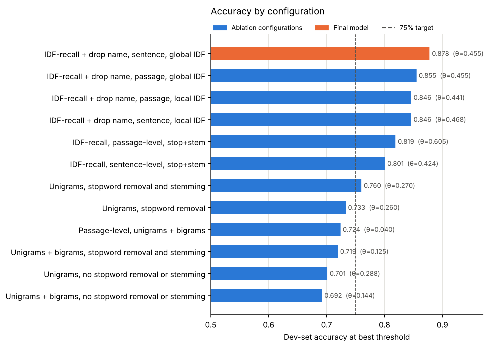
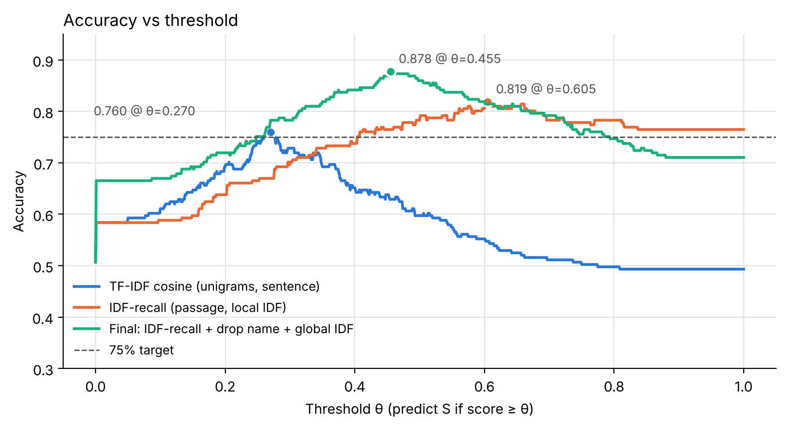
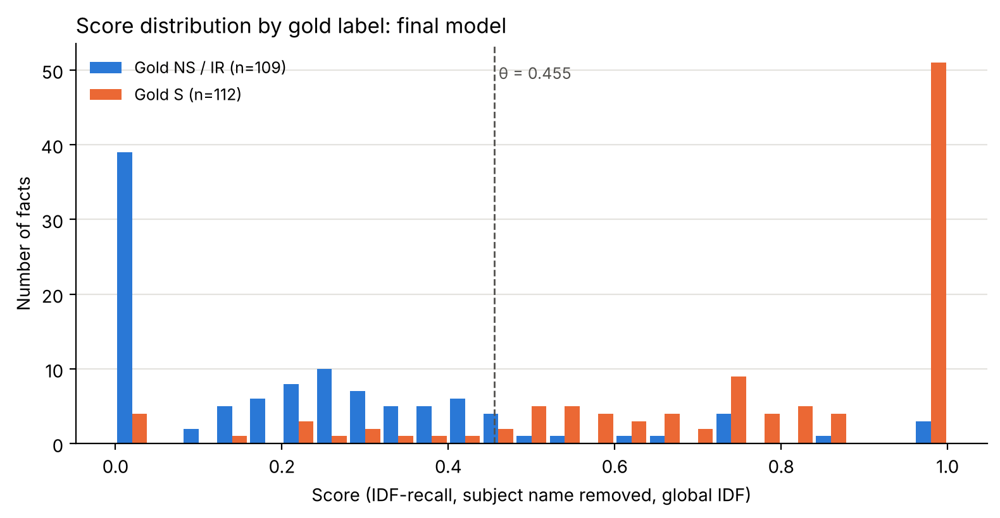
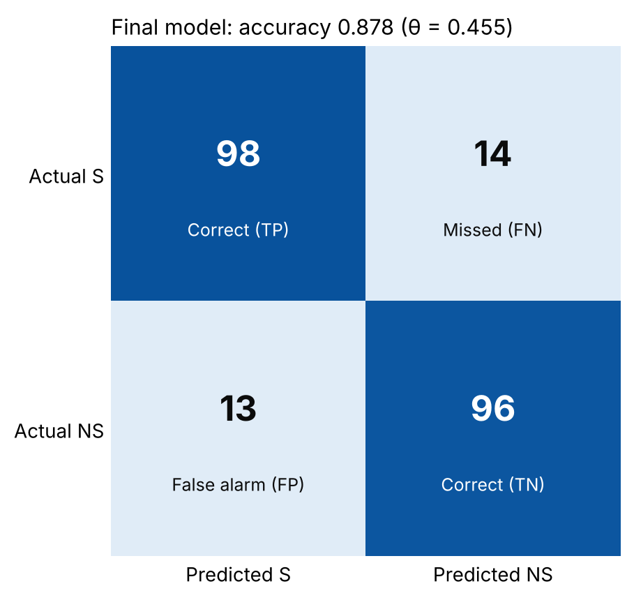

# TF-IDF Notebook: Full Walkthrough

**Notebook:** `Task_A/rumaiz_tf-idf/tfidf.ipynb`
**Task:** Part 1, word-overlap fact checking
**Final result:** IDF-weighted recall, passage level, θ = 0.605 -> **181 / 221 = 81.9%** accuracy (target ≥ 75%)

This document will explain every section of the notebook in order: what each step does, why it was done that way, and what it produced.

---

## Contents

1. [Goal and overview](#goal-and-overview)
2. [Section 1: Imports](#section-1-imports)
3. [Section 2: Data loading](#section-2-data-loading)
4. [Section 3: Label mapping and example construction](#section-3-label-mapping-and-example-construction)
5. [Section 4: Preprocessing (stopwords and stemming)](#section-4-preprocessing-stopwords-and-stemming)
6. [Section 5: Tokenization, n-grams and sentence splitting](#section-5-tokenization-n-grams-and-sentence-splitting)
7. [Section 6: TF-IDF vectors and cosine similarity](#section-6-tf-idf-vectors-and-cosine-similarity)
8. [Section 7: IDF-weighted recall](#section-7-idf-weighted-recall)
9. [Section 8: Evaluation metrics and threshold search](#section-8-evaluation-metrics-and-threshold-search)
10. [Section 9: Baseline results](#section-9-baseline-results)
11. [Section 10: Threshold sensitivity](#section-10-threshold-sensitivity)
12. [Section 11: Ablation study](#section-11-ablation-study)
13. [Section 12: Visualisations](#section-12-visualisations)
14. [Robustness: 5-fold cross-validation](#robustness-5-fold-cross-validation)
15. [Final model in factcheck.py](#final-model-in-factcheckpy)
16. [Limitations](#limitations)
17. [Output files](#output-files)
18. [How to reproduce](#how-to-reproduce)

---

## Goal and overview

Each example is an **atomic fact**, a short claim taken from a ChatGPT-written biography, such as *"Marianne McAndrew was born in Cleveland."* Each fact comes with Wikipedia **passages** retrieved by BM25. The task is to predict:

- **S** (Supported): the passages back the fact up
- **NS** (Not Supported): they don't

The notebook uses **lexical overlap only** (no neural models):

```
fact + passages -> preprocess -> overlap score ∈ [0, 1] -> predict S if score ≥ θ
```

Two scoring methods are built and compared: **TF-IDF cosine similarity** and **IDF-weighted recall**. Every preprocessing choice is tested in an ablation study, and the threshold θ is tuned by grid search.

---

## Section 1: Imports

| Library | Used for |
|---|---|
| `json`, `re`, `csv`, `pathlib` | reading data, regex cleaning, file paths |
| `collections.Counter`, `math.log/sqrt` | term counts and TF-IDF maths |
| `numpy` | score arrays and metrics |
| `nltk.stem.PorterStemmer` | stemming |
| `spacy.lang.en.stop_words.STOP_WORDS` | stopword list |
| `matplotlib.pyplot` | figures |

A fixed seed (`SEED = 42`) is set for reproducibility.

**Design choice:** TF-IDF, cosine and all metrics are implemented **from scratch with plain Python dictionaries**, without scikit-learn, so every step of the maths is visible and explainable.

---

## Section 2: Data loading

| File | Contents | Records |
|---|---|---|
| `data/dev_labeled_ChatGPT.jsonl` | ChatGPT biographies with human-annotated atomic facts and labels | 31 biographies |
| `data/passages_bm25_ChatGPT_humfacts.jsonl` | For each fact, the BM25-retrieved Wikipedia passages | 5,427 passage records |

- `read_jsonl()` reads JSON Lines safely, skips blank lines, and reports the line number if a line is malformed.
- A data-inspection cell prints the record keys and one example of each file:
  - Biography keys: `input`, `output`, `topic`, `cat`, `annotations`
  - Passage keys: `name`, `sent`, `passages`

---

## Section 3: Label mapping and example construction

### Labels

| Label | Meaning | Mapped to |
|---|---|---|
| **S** | Supported by Wikipedia | 1 |
| **NS** | False, or not stated in Wikipedia | 0 |
| **IR** | Irrelevant: not about the subject | 0 |

**IR examples from the data:**
- *Wrong person:* "Fernandinho has earned over 50 caps." (in the bio of *Fernando*, a different footballer)
- *General knowledge:* "Cleveland is in Ohio." (in the bio of *Marianne McAndrew*)

IR is mapped to NS because `factchecking_main.py` does the same (`"NS" if label == "IR"`), so the notebook evaluates exactly like the marking script.

### Building examples

1. Build a lookup `fact_to_passage` from each passage record's `sent` (the fact text) to its `passages`.
2. Walk every biography → every sentence annotation → every **human** atomic fact. Human facts are used rather than model-extracted ones, to avoid errors from the fact-extraction step.
3. Each example stores `fact`, `passages`, `label` and `gold_binary` (1/0).

### Output

```
Labels found: ['IR', 'NS', 'S']
Label counts: {'NS': 93, 'S': 112, 'IR': 16}
Usable examples: 221
Missing passage matches: 0
```

| | Count |
|---|---|
| Supported (S) | 112 |
| Not supported (NS + IR) | 109 |
| **Total** | **221** |

A majority-class guess ("always S") would score **112 / 221 = 50.7%**.

---

## Section 4: Preprocessing (stopwords and stemming)

### Stopwords

- **Original:** a short hand-written list (articles, pronouns, *be*-verbs, prepositions). It's kept in the notebook for comparison.
- **Final:** spaCy's English stopword list (about 326 words).
  - It needs **no download**, so it also works inside `factcheck.py` on the marker's machine.
  - It removes words like *also, has, who, which* that the short list missed. These appear in almost every passage and inflate overlap for unsupported facts.

### Negations are kept

`no, not, nor, never, none, n't` are **removed from the stopword list**, so they stay in the text.

> If *"not"* were removed, *"X did **not** win the award"* would look identical to *"X won the award"*, and contradicting evidence would look like support.

### Stemming

The Porter stemmer collapses variants of the same word:

| Words | Stem |
|---|---|
| acting, acted, acts | `act` |
| cats | `cat` |
| quickly | `quickli` |

This lets *"acted in films"* match *"acting career"*.

---

## Section 5: Tokenization, n-grams and sentence splitting

### `tokenize(text)`

```
lowercase → strip <s>…</s> tags → punctuation → spaces → split → remove stopwords → stem
```

**Digits are kept on purpose:** years and dates (*1942*, *2019*) are often the exact detail that decides whether a biography fact is true.

**Example output:**
```
tokenize("The cats were running quickly.") → ['cat', 'run', 'quickli']
```

### `make_ngrams(tokens, ngram_range)`

Generates unigrams, and optionally bigrams, joined with `_`:
```
make_ngrams(['solar','panel','fault'], (1,2))
→ ['solar', 'panel', 'fault', 'solar_panel', 'panel_fault']
```

### `split_into_sentences(text)`

Splits a passage after `.`, `!` or `?` followed by whitespace. This allows two **evidence granularities**:

| Level | Evidence unit |
|---|---|
| Sentence level | each sentence of each passage |
| Passage level | each whole passage |

### `get_passage_text(passage)`

Safely extracts text from a passage stored as either a dictionary (`{"title", "text"}`) or a plain string.

---

## Section 6: TF-IDF vectors and cosine similarity

### Formulas

| Component | Formula | Why |
|---|---|---|
| Term frequency | TF = 1 + log(count) | log scaling, so repeated words don't dominate |
| Inverse document frequency | IDF = log((N + 1) / (df + 1)) + 1 | smoothed, so it's never zero or negative |
| Weight | w = TF × IDF | |
| Normalisation | divide by L2 norm | so cosine = dot product, in [0, 1] |
| Cosine similarity | cos(q, d) = Σ q_t · d_t | |

### Functions

| Function | What it does |
|---|---|
| `term_frequency()` | counts each token or n-gram |
| `build_tfidf_vectors()` | builds normalised TF-IDF vectors for a list of documents |
| `cosine_similarity_sparse()` | dot product of two sparse dictionaries, iterating the smaller one for speed |
| `tfidf_score()` | full pipeline for one fact → max cosine over evidence units |

### Key design decisions

1. **Local IDF corpus.** IDF is computed over `[fact] + that fact's evidence units` only. "Rare" therefore means rare within this person's Wikipedia text, which **automatically down-weights the subject's name** (it appears in every unit).
2. **Max over evidence units.** A fact only needs to be supported **somewhere** in the evidence, not everywhere.

---

## Section 7: IDF-weighted recall

### Why a second metric?

Cosine similarity is **symmetric**: it penalises the evidence for containing words the fact doesn't have. But:

- facts are short (5–10 words)
- evidence is long (sentences, or whole passages of about 1,000 characters)

So a passage that fully supports a fact can still get a low cosine score, just because it says other things too.

The real question is **asymmetric**: *how much of the fact is covered by the evidence?* That's **recall**.

### Formula

$$\text{IDF-recall}(f, u) = \frac{\sum_{t \in F \cap U} \text{idf}(t)}{\sum_{t \in F} \text{idf}(t)}$$

- *F* = the set of the fact's terms; *U* = the set of the evidence unit's terms
- Final score = **max** over all evidence units
- **1.0** = every content word of the fact appears in that unit

### Why weight by IDF?

| Fact word | How common in the evidence | IDF weight |
|---|---|---|
| *McAndrew* (subject's name) | in every passage | low |
| *born* | fairly common | medium |
| *Cleveland* | rare | **high** |

Matching *Cleveland* counts much more than matching the person's name.

### Functions

| Function | What it does |
|---|---|
| `compute_idf()` | smoothed IDF over the fact plus its evidence units (same formula as Section 6) |
| `idf_recall_score()` | IDF-weighted recall, max over units; supports sentence or passage level |

This also matches the framework's class name: **`WordRecallThresholdFactChecker`**.

---

## Section 8: Evaluation metrics and threshold search

### Decision rule
```
predict S  if  score ≥ θ
predict NS otherwise
```

### `compute_metrics(y_true, scores, θ)`

Implemented from scratch in NumPy. It returns accuracy, precision, recall, F1 (for the S class), TP, TN, FP and FN.

### `find_best_threshold(y_true, scores)`

- **Grid search** over θ ∈ [0, 1] in steps of **0.001** (1,001 thresholds)
- **Objective:** maximise **accuracy**, which is what the brief grades
- **Tie-break:** S-class **F1**. With 221 examples accuracy moves in steps of 1/221 ≈ 0.45%, so ties are common; F1 prefers the threshold with more balanced precision and recall.
- Tuning on the dev set is explicitly allowed by the brief.

### `score_examples(examples, config)`

Scores all 221 facts with one configuration. The config's `"metric"` key chooses `tfidf_score` (default) or `idf_recall_score`.

---

## Section 9: Baseline results

**Baseline configuration:** TF-IDF cosine, unigrams + bigrams, sentence level, stopword removal and stemming.

| Metric | Value |
|---|---|
| Score range | 0.000 – 0.723 (mean 0.211, std 0.146) |
| Best θ | 0.125 |
| **Accuracy** | **0.7195** |
| Precision | 0.669 |
| Recall | 0.884 |
| F1 | 0.762 |

|  | Predicted NS | Predicted S |
|---|---|---|
| **Actual NS** | 60 | 49 |
| **Actual S** | 13 | 99 |

**Interpretation:** the baseline falls **below the 75% target**. Bigrams make cosine scores small and noisy for short facts, so the best threshold is very low (0.125) and **49 NS facts slip through as false positives**. This motivates the ablation study.

---

## Section 10: Threshold sensitivity

Accuracy at ±0.05 around the baseline's chosen θ:

| θ | Accuracy | Precision | Recall | F1 |
|---|---|---|---|---|
| 0.075 | 0.638 | 0.587 | 0.964 | 0.730 |
| 0.095 | 0.679 | 0.626 | 0.911 | 0.742 |
| 0.115 | 0.692 | 0.643 | 0.884 | 0.744 |
| **0.125** | **0.719** | 0.669 | 0.884 | 0.762 |
| 0.135 | 0.710 | 0.669 | 0.848 | 0.748 |
| 0.155 | 0.701 | 0.674 | 0.795 | 0.730 |
| 0.175 | 0.701 | 0.692 | 0.741 | 0.716 |

**Interpretation:** the baseline's accuracy has a **sharp peak**. Moving θ by just ±0.01 loses about 1 point, and ±0.05 loses up to 8. That means it is fragile and likely overfit to the dev set. The final model (Section 11) has a broad plateau instead (see Figure 2).

---

## Section 11: Ablation study

An **ablation study** changes **one design choice at a time** and measures its effect. Each configuration gets **its own best threshold**, so the comparison is fair.

| Design choice | Options compared |
|---|---|
| Similarity metric | TF-IDF cosine vs IDF-weighted recall |
| Evidence unit | sentence vs whole passage |
| N-grams | unigrams vs unigrams + bigrams |
| Stopword removal | on vs off |
| Stemming | on vs off |

### Results (sorted best first)

| Rank | Configuration | θ | Accuracy | Precision | Recall | F1 |
|---|---|---|---|---|---|---|
| 🥇 1 | **IDF-recall, passage level, stop + stem** | 0.605 | **0.8190** | 0.8830 | 0.7411 | 0.8058 |
| 2 | IDF-recall, sentence level, stop + stem | 0.424 | 0.8009 | 0.7698 | 0.8661 | 0.8151 |
| 3 | Cosine, unigrams, stop + stem | 0.270 | 0.7602 | 0.7360 | 0.8214 | 0.7764 |
| 4 | Cosine, unigrams, stop only (no stem) | 0.260 | 0.7330 | 0.7154 | 0.7857 | 0.7489 |
| 5 | Cosine, passage level, uni + bigrams | 0.040 | 0.7240 | 0.6584 | 0.9464 | 0.7766 |
| 6 | Cosine, uni + bigrams, stop + stem *(baseline)* | 0.125 | 0.7195 | 0.6689 | 0.8839 | 0.7615 |
| 7 | Cosine, unigrams, no stop / no stem | 0.288 | 0.7014 | 0.7300 | 0.6518 | 0.6887 |
| 8 | Cosine, uni + bigrams, no stop / no stem | 0.144 | 0.6923 | 0.6667 | 0.7857 | 0.7213 |

The results are also exported to `ablation_results.csv`.

### Findings

| Finding | Evidence | Explanation |
|---|---|---|
| **IDF-recall beats every cosine variant** | 0.819 vs 0.760 (+5.9 pts) | Recall asks *"is the fact covered?"* and isn't penalised by long evidence |
| **Stopword removal + stemming help** | 0.701 → 0.760 (+5.9 pts) | Function words add noise; stemming matches word variants |
| **Stemming alone helps** | 0.733 → 0.760 (+2.7 pts) | *acted* now matches *acting* |
| **Bigrams hurt** | 0.760 → 0.720 (−4.0 pts) | 5–10 word facts rarely share exact two-word phrases with Wikipedia |
| **Passage level helps recall** | 0.801 → 0.819 (+1.8 pts) | Facts are often split across sentences (*"She appeared in…"* with the name in the previous sentence) |
| **Passage level hurts cosine** | needs θ = 0.04, precision 0.66 | Long passages dilute cosine scores, so almost everything has to be predicted S |

---

## Section 12: Visualisations

All figures are saved to `figures/` at 200 dpi.

### Figure 1: Accuracy by configuration


Horizontal bars, one per ablation configuration; the dashed line marks the 75% target. Both IDF-recall configurations clear it comfortably; only one cosine configuration does.

### Figure 2: Accuracy vs threshold


The best cosine configuration against the best IDF-recall configuration, across all thresholds.

- **Cosine (blue):** a **sharp peak** of 0.760 at θ = 0.270, dropping quickly on both sides.
- **IDF-recall (orange):** a **broad plateau**. Accuracy is ≥ 80% for θ ∈ [0.56, 0.68] and ≥ 75% for θ ∈ [0.40, 1.0].

This is the key evidence that the IDF-recall threshold is **robust, not overfit**.

### Figure 3: Score distribution by gold label


IDF-recall scores for gold NS (blue) vs gold S (orange) facts, with θ = 0.605 marked.

- **65 supported facts score exactly 1.0**: every content word appears in a passage.
- Most NS facts score below 0.6, and 18 score 0.0 (none of the content words appear in the passages).
- The **overlap region (about 0.4–0.7)** is where errors happen.

### Figure 4: Confusion matrix (final model)


|  | Predicted S | Predicted NS |
|---|---|---|
| **Actual S** | ✅ 83 (TP) | ❌ 29 (FN, missed) |
| **Actual NS** | ❌ 11 (FP, false alarm) | ✅ 98 (TN) |

| Metric | S class | NS class |
|---|---|---|
| Precision | 0.883 | 0.772 |
| Recall | 0.741 | 0.899 |
| F1 | 0.806 | 0.831 |

The model is **conservative**: when it says "supported" it is right 88% of the time, but it misses about a quarter of truly supported facts, mostly paraphrases.

---

## Robustness: 5-fold cross-validation

Because the threshold is tuned and evaluated on the same 221 facts, a 5-fold cross-validation estimates performance on **unseen** facts:

1. Shuffle the facts (seed 42) and split them into 5 folds.
2. For each fold, tune θ on the other 4 folds, then test on the held-out fold.

| Fold | Chosen θ | Train accuracy | Held-out accuracy | n |
|---|---|---|---|---|
| 1 | 0.604 | 0.824 | 0.778 | 45 |
| 2 | 0.601 | 0.836 | 0.727 | 44 |
| 3 | 0.605 | 0.831 | 0.773 | 44 |
| 4 | 0.657 | 0.814 | 0.818 | 44 |
| 5 | 0.605 | 0.802 | 0.886 | 44 |
| **Mean** | 0.601 – 0.657 | | **0.796 ± 0.053** | |

**Interpretation:**
- Held-out accuracy (**79.6%**) is only about 2 points below the dev-tuned 81.9%, and still well above the 75% target.
- The threshold lands near **0.60** in 4 of 5 folds, so it reflects a real pattern rather than luck.

> **Note:** add the CV cell to the end of Section 11 so this table is reproduced inside the notebook. The Findings cell already quotes 79.6%.

---

## Final model in factcheck.py

The winning configuration is implemented in `factcheck.py` as `WordRecallThresholdFactChecker`:

| Setting | Value |
|---|---|
| Metric | IDF-weighted recall |
| Evidence unit | whole passage |
| Stopwords | spaCy English list minus negations |
| Stemming | Porter |
| N-grams | unigrams |
| Threshold | **0.605** |

Running `python factchecking_main.py --mode word_overlap` gives:

```
83      29
11      98
Accuracy: 181/221 = 0.8190045248868778
Prec for S: 83/94 = 0.883    Rec for S: 83/112 = 0.741    F1 for S: 0.806
Prec for NS: 98/127 = 0.772  Rec for NS: 98/109 = 0.899   F1 for NS: 0.831
```

This exactly matches the notebook. It scores all 221 facts in **under 1 second** and needs no downloads or GPU.

---

## Limitations

| Limitation | Example | Effect |
|---|---|---|
| **Paraphrase** | Fact: *"actress"*; Wikipedia: *"appeared in films"* | missed support (FN) |
| **Wrong detail, same words** | *"born November 21, 1942"* vs evidence saying November 22 | false alarm (FP) |
| **Word order ignored** | *"born in Ohio, died in California"* vs the reverse | can't distinguish them |
| **Vague or subjective claims** | *"Protect the Boss is popular"*, *"X is legendary"* | rarely stated verbatim → FN or unreliable |
| **General-knowledge IR facts** | *"Cleveland is in Ohio."* | words match, but gold label is NS → FP risk |
| **Tuned and evaluated on the same set** | θ chosen on all 221 facts | reported 81.9% is slightly optimistic (CV: 79.6%) |

These limits come from bag-of-words matching, which checks whether the **words** match rather than whether the **meaning** matches. Part 2 (textual entailment with DeBERTa-v3) is designed to address this, and the IDF-recall score is reused there as a fast **pruning filter**.

---

## Output files

| File | Contents |
|---|---|
| `tfidf.ipynb` | all code, experiments and outputs |
| `ablation_results.csv` | ablation table (8 configurations × all metrics) |
| `figures/ablation_accuracy.png` | Figure 1 |
| `figures/accuracy_vs_threshold.png` | Figure 2 |
| `figures/score_distribution.png` | Figure 3 |
| `figures/confusion_matrix.png` | Figure 4 |
| `TFIDF.md` | method explanation with formulas |
| `RESULTS.md` | results summary in plain language |
| `NOTEBOOK_SUMMARY.md` | this document |
| `../../factcheck.py` | final `WordRecallThresholdFactChecker` |

---

## How to reproduce

```bash
# from the project root
python3.10 -m venv .venv
source .venv/bin/activate
pip install -r requirements.txt

# notebook: open Task_A/rumaiz_tf-idf/tfidf.ipynb → Kernel → Restart & Run All

# marking script
python factchecking_main.py --mode word_overlap   # → Accuracy: 181/221 = 0.819
```

Requirements: Python 3.10; `numpy`, `nltk`, `spacy` (from `requirements.txt`), plus `matplotlib` for the figures (notebook only, not needed by `factcheck.py`).
