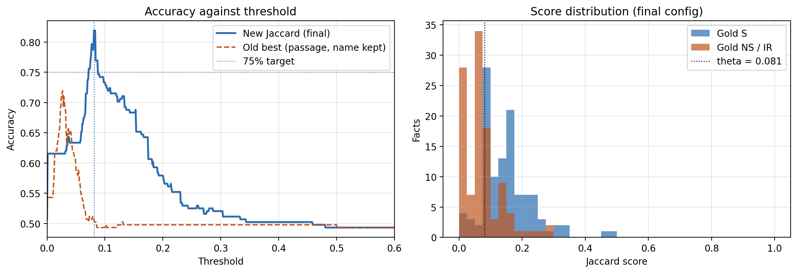

# Part 1: Jaccard similarity (Tamadhi), version 2

_Generated by jaccard_experiments_v2.ipynb on 2026-11-09 21:41._

## Findings

1. **Overall:** accuracy rose from 0.719 (159/221) with the previous best setting to 0.819 (181/221), +22 fact(s), above the 75% target. 5-fold CV rose from 0.696 to 0.819.
2. **Name removal:** the best setting that keeps the subject's name scores 0.783; the best that removes it scores 0.814 (+7 fact(s)). The name occurs in almost every retrieved passage, so keeping it makes unsupported facts look supported.
3. **Evidence unit (name removed):** passage 0.729, sentence 0.742, window 0.814. The window unit is best. Jaccard divides by the union, so a long passage makes every score small; a shorter unit keeps the union close to the size of the fact.
4. **Window size:** 4 words 0.796, 6 words 0.805, 8 words 0.814, 10 words 0.810, 12 words 0.819, 16 words 0.778, 20 words 0.760. The best is 12 words (stride 6).
5. **One change at a time (facts gained or lost vs the final setting):** Unit = passage -31; No stopword removal -30; Unit = sentence -27; Name kept -13; IDF weighting on -10; No stemming -7; Other tokenizer -6.
6. **Robustness:** 5-fold CV is 0.819 ± 0.033 and CV with whole biographies held out is 0.820, against 0.819 on the full set, so the result is not an artefact of tuning on all 221 facts. The best threshold plateau is 0.081–0.083; accuracy stays at or above 75% for theta between 0.072 and 0.087.
7. **Errors:** false positives went from 52 to 27 and false negatives from 10 to 13. The remaining false positives share the content words but differ in a detail word overlap cannot check (highest: "Gerhard Fischer invented the first handheld, battery-operated metal detector in 1931.", score 0.279). 4 false negatives score 0 because the fact and the passage use different words for the same thing (e.g. "Hibo Wardere is based in the United Kingdom.").

## Results

### Data

| Item | Count |
|---|---|
| Facts | 221 |
| Biographies | 31 |
| Gold S | 112 |
| Gold NS | 93 |
| Gold IR (counted as NS) | 16 |
| Binary S / NS | 112 / 109 |

### Baseline: previous best configuration

| Grid step | theta | Correct | Accuracy | 5-fold CV | Grouped CV | F1 (S) |
|---|---|---|---|---|---|---|
| 0.01 (old notebook) | 0.030 | 155/221 | 0.7014 | -- | -- | 0.732 |
| 0.001 (this notebook) | 0.027 | 159/221 | 0.7195 | 0.696 ± 0.071 | 0.693 | 0.767 |

NLTK tokenizer, stopwords removed, Porter stemming, whole passage, max, name kept, unweighted.

### Grid search: top 15 of 48 configurations

| Rank | Tokenizer | Name | Unit | IDF | Aggregation | theta | Accuracy | 5-fold CV | Grouped CV | F1 (S) |
|---|---|---|---|---|---|---|---|---|---|---|
| 1 | nltk | removed | window | no | top2 | 0.119 | 0.8145 | 0.796 | 0.804 | 0.821 |
| 2 | regex | removed | window | no | top2 | 0.102 | 0.8054 | 0.801 | 0.803 | 0.826 |
| 3 | nltk | removed | window | no | max | 0.112 | 0.8009 | 0.791 | 0.786 | 0.810 |
| 4 | nltk | removed | window | yes | max | 0.100 | 0.7919 | 0.774 | 0.771 | 0.819 |
| 5 | nltk | removed | window | yes | top2 | 0.090 | 0.7919 | 0.769 | 0.781 | 0.819 |
| 6 | regex | removed | window | no | max | 0.112 | 0.7873 | 0.773 | 0.770 | 0.798 |
| 7 | regex | removed | window | yes | max | 0.100 | 0.7873 | 0.760 | 0.752 | 0.814 |
| 8 | regex | removed | window | yes | top2 | 0.092 | 0.7873 | 0.755 | 0.743 | 0.814 |
| 9 | nltk | kept | window | no | top2 | 0.181 | 0.7828 | 0.751 | 0.759 | 0.800 |
| 10 | regex | kept | window | no | top2 | 0.181 | 0.7692 | 0.737 | 0.747 | 0.790 |
| 11 | regex | kept | window | yes | top2 | 0.247 | 0.7466 | 0.728 | 0.737 | 0.748 |
| 12 | regex | kept | window | no | max | 0.167 | 0.7466 | 0.710 | 0.709 | 0.783 |
| 13 | regex | kept | window | yes | max | 0.255 | 0.7421 | 0.719 | 0.733 | 0.749 |
| 14 | nltk | removed | sentence | yes | max | 0.052 | 0.7421 | 0.715 | 0.719 | 0.747 |
| 15 | nltk | removed | sentence | yes | top2 | 0.029 | 0.7376 | 0.733 | 0.714 | 0.752 |

All rows remove stopwords and stem. Windows are 8 tokens, stride 4. The full grid is in results/grid_v2.csv.

### Name removal and evidence unit

| Unit | Name kept: acc | Name kept: CV | Name removed: acc | Name removed: CV |
|---|---|---|---|---|
| passage | 0.7195 | 0.696 | 0.7285 | 0.683 |
| sentence | 0.6923 | 0.660 | 0.7421 | 0.715 |
| window | 0.7828 | 0.751 | 0.8145 | 0.796 |

Best configuration in each cell (tokenizer, IDF and aggregation free).

### Window size

| Window | Stride | theta | Accuracy | 5-fold CV | Grouped CV |
|---|---|---|---|---|---|
| 4 | 2 | 0.191 | 0.7964 | 0.773 | 0.771 |
| 6 | 3 | 0.143 | 0.8054 | 0.787 | 0.799 |
| 8 | 4 | 0.119 | 0.8145 | 0.796 | 0.804 |
| 10 | 5 | 0.096 | 0.8100 | 0.792 | 0.810 |
| 12 | 6 | 0.081 | 0.8190 | 0.819 | 0.820 |
| 16 | 8 | 0.061 | 0.7783 | 0.760 | 0.769 |
| 20 | 10 | 0.055 | 0.7602 | 0.742 | 0.717 |

Other settings fixed at the best window row of the grid: {'tokenizer': 'nltk', 'remove_stop': True, 'stem_on': True, 'drop_title': True, 'weighted': False, 'aggregation': 'top2'}.

### Final configuration

| Setting | Value |
|---|---|
| Tokenizer | nltk |
| Stopwords removed | True |
| Porter stemming | True |
| Subject name removed | True |
| Evidence unit | window (12 tokens, stride 6) |
| IDF weighting | False |
| Aggregation | top2 |
| Threshold theta | 0.081 |
| Accuracy | 0.8190 (181/221) |
| Best plateau | 0.081 to 0.083 |
| theta range with accuracy >= 75% | 0.072 to 0.087 |
| 5-fold CV (seed 42) | 0.819 ± 0.033 |
| Grouped CV (whole biographies) | 0.820 ± 0.040 |

### Cross-validation folds

| Fold | Random folds | Grouped by biography |
|---|---|---|
| 1 | 0.867 | 0.825 |
| 2 | 0.773 | 0.878 |
| 3 | 0.818 | 0.806 |
| 4 | 0.795 | 0.755 |
| 5 | 0.841 | 0.836 |

### One change at a time

| Setting | theta | Correct | Accuracy | 5-fold CV | Grouped CV | P (S) | R (S) | F1 (S) |
|---|---|---|---|---|---|---|---|---|
| Final | 0.081 | 181/221 | 0.8190 | 0.819 | 0.820 | 0.786 | 0.884 | 0.832 |
| Name kept | 0.130 | 168/221 | 0.7602 | 0.724 | 0.712 | 0.706 | 0.902 | 0.792 |
| No stopword removal | 0.166 | 151/221 | 0.6833 | 0.642 | 0.625 | 0.681 | 0.705 | 0.693 |
| No stemming | 0.081 | 174/221 | 0.7873 | 0.778 | 0.780 | 0.783 | 0.804 | 0.793 |
| IDF weighting on | 0.067 | 171/221 | 0.7738 | 0.742 | 0.734 | 0.725 | 0.893 | 0.800 |
| Other tokenizer | 0.077 | 175/221 | 0.7919 | 0.792 | 0.786 | 0.746 | 0.893 | 0.813 |
| Unit = passage | 0.020 | 150/221 | 0.6787 | 0.642 | 0.630 | 0.720 | 0.598 | 0.654 |
| Unit = sentence | 0.032 | 154/221 | 0.6968 | 0.696 | 0.654 | 0.674 | 0.777 | 0.722 |

Each row is the final configuration with one setting changed; theta is retuned for every row.

### Per-class results

| Class | Precision | Recall | F1 |
|---|---|---|---|
| S | 0.786 | 0.884 | 0.832 |
| NS | 0.863 | 0.752 | 0.804 |

Accuracy 0.8190 (181/221).

### Confusion matrix

|  | Predicted S | Predicted NS |
|---|---|---|
| Gold S | 99 | 13 |
| Gold NS / IR | 27 | 82 |

### False positives (27 in total, 10 highest scores)

| # | Fact | Gold | Score |
|---|---|---|---|
| 1 | Gerhard Fischer invented the first handheld, battery-operated metal detector in 1931. | NS | 0.279 |
| 2 | The Fischer Research Laboratory was founded in 1936. | NS | 0.275 |
| 3 | With CSKA, he won three Russian Premier League titles. | NS | 0.258 |
| 4 | He has worked at Mayo Clinic. | NS | 0.240 |
| 5 | The Fischer Research Laboratory became one of the world's leading manufacturers of metal detectors. | NS | 0.213 |
| 6 | Trivisonno started his radio career at WIXY 1260 AM. | NS | 0.182 |
| 7 | Cleveland is in Ohio. | IR | 0.174 |
| 8 | Salazar earned 28 caps for the Peru national team. | IR | 0.167 |
| 9 | Mayo Clinic is an organization. | NS | 0.160 |
| 10 | Haagensen began his acting career when he was 15 years old. | NS | 0.153 |

### False negatives (13 in total, 10 lowest scores)

| # | Fact | Gold | Score |
|---|---|---|---|
| 1 | Hibo Wardere is based in the United Kingdom. | S | 0.000 |
| 2 | Florencia Bertotti is an Argentinian. | S | 0.000 |
| 3 | Haagensen later transitioned to television. | S | 0.000 |
| 4 | They divorced in 1964. | S | 0.000 |
| 5 | Jean Daullé was born in 1703. | S | 0.038 |
| 6 | Jean Daullé died in 1763. | S | 0.038 |
| 7 | Jonathan Haagensen is a Brazilian. | S | 0.042 |
| 8 | He served for many years as a pastor. | S | 0.071 |
| 9 | Haagensen later transitioned to film. | S | 0.074 |
| 10 | Rennie Fritchie is a public servant. | S | 0.077 |

### Figure

